<div align="center">


<br/><br/>

<a href="https://www.linkedin.com/in/nitin-maharaj-851987322"></a>
<a href="mailto:nitinmaharaj8866@gmail.com"></a>
<a href="https://github.com/Nitin8866"></a>
<a href="https://github.com/Nitin8866?tab=followers"></a>


</div>

<br/>

<!-- SYSTEM ANNOUNCEMENT BANNER -->
<div align="center">
  <a href="mailto:nitinmaharaj8866@gmail.com">
    
  </a>
</div>

<br/>

<!-- TOP NAVIGATION BAR -->
<div align="center">
  <a href="#overview"></a>
  <a href="#about-me"></a>
  <a href="#tech-stack"></a>
  <a href="#skill-proficiency"></a>
  <a href="#featured-projects"></a>
  <a href="#github-analytics"></a>
  <a href="#system-quality"></a>
  <a href="#architecture"></a>
  <a href="#system-workflow"></a>
  <a href="#installation-guide"></a>
  <a href="#project-roadmap"></a>
  <a href="#faq"></a>
  <a href="#connect"></a>
</div>

<br/>

<!-- EXECUTIVE OVERVIEW MATRIX -->
<a name="overview"></a>
<h3 align="center">EXECUTIVE SUMMARY</h3>

<div align="center">
  
</div>

<br/>

<!-- ABOUT ME -->
<a name="about-me"></a>
<div align="center">
  <a href="mailto:nitinmaharaj8866@gmail.com">
    
  </a>
</div>

<br/>

<!-- TECH STACK -->
<a name="tech-stack"></a>
<h3 align="center">TECHNOLOGY ECOSYSTEM</h3>

<div align="center">


<br/><br/>


</div>

<br/>

<!-- SKILL PROFICIENCY -->
<a name="skill-proficiency"></a>
<h3 align="center">SKILL PROFICIENCY MATRIX</h3>

<div align="center">
  
</div>

<br/>

<!-- FEATURED PROJECTS -->
<a name="featured-projects"></a>
<h3 align="center">FEATURED PROJECTS &amp; WORK</h3>

<div align="center">
  
</div>

<br/>

<!-- GITHUB ANALYTICS -->
<a name="github-analytics"></a>
<h3 align="center">ANALYTICS &amp; METRICS DASHBOARD</h3>

<div align="center">
  
  <br/><br/>
  
  
  
  
</div>

<br/>

<!-- ACHIEVEMENT BADGES -->
<h3 align="center">ACHIEVEMENTS &amp; MILESTONES</h3>

<div align="center">
  
</div>

<br/>

<!-- 3D CONTRIBUTION GLOBE -->
<h3 align="center">3D CONTRIBUTION GLOBE</h3>

<div align="center">


</div>

<details>
<summary><strong>CLICK TO ENABLE 3D GLOBE — One-time GitHub Action setup (2 minutes)</strong></summary>
<br/>

Create this file: `.github/workflows/globe.yml`

```yaml
name: GitHub 3D Contribution Globe

on:
  schedule:
    - cron: "0 18 * * *"
  workflow_dispatch:
  push:
    branches:
      - main

jobs:
  build:
    runs-on: ubuntu-latest
    name: Generate 3D Contribution Globe
    steps:
      - uses: actions/checkout@v3
      - uses: yoshi389111/github-profile-3d-contrib@0.7.1
        env:
          GITHUB_TOKEN: ${{ secrets.GITHUB_TOKEN }}
          USERNAME: Nitin8866
      - name: Commit and push
        run: |
          git config --global user.name "github-actions[bot]"
          git config --global user.email "github-actions[bot]@users.noreply.github.com"
          git add -A .
          git commit -m "Update 3D contribution globe" --allow-empty
          git push
```

After committing, go to **Actions tab &rarr; GitHub 3D Contribution Globe &rarr; Run workflow**.

</details>

<br/>

<!-- SYSTEM QUALITY INDICATORS -->
<a name="system-quality"></a>
<h3 align="center">SYSTEM QUALITY METRICS</h3>

<div align="center">
  
</div>

<br/>

<!-- ARCHITECTURE -->
<a name="architecture"></a>
<h3 align="center">SYSTEM ARCHITECTURE PATTERNS</h3>

<div align="center">
  
</div>

<br/>

<!-- WORKFLOW PIPELINE -->
<a name="system-workflow"></a>
<h3 align="center">SYSTEM WORKFLOW PIPELINE</h3>

<div align="center">
  
</div>

<br/>

<!-- INSTALLATION GUIDE -->
<a name="installation-guide"></a>
<h3 align="center">PROJECT SETUP &amp; INSTALLATION GUIDE</h3>

<div align="center">
  
</div>

<details>
<summary><strong>COPY QUICK-START BASH COMMANDS</strong></summary>
<br/>

**Prerequisites:** Ensure `PHP 8.x`, `Composer`, `Node.js (v18+)`, `npm/yarn`, `MySQL`, and `Flutter SDK` are installed.

```bash
# Clone Repository
git clone https://github.com/Nitin8866/Nitin8866.git
cd Nitin8866

# Laravel Backend Dependencies
composer install
cp .env.example .env
php artisan key:generate

# Frontend / Node.js Dependencies
npm install

# Launch Concurrent Development Servers
php artisan serve
npm run dev
```

</details>

<br/>

<!-- PROJECT STRUCTURE -->
<a name="repo-tree"></a>
<h3 align="center">WORKSPACE REPOSITORY TREE</h3>

<div align="center">
  
</div>

<br/>

<!-- CONTRIBUTION SNAKE -->
<a name="contribution-snake"></a>
<h3 align="center">CONTRIBUTION SNAKE GRAPH</h3>

<div align="center">


</div>

<details>
<summary><strong>CLICK TO VIEW WORKFLOW CONFIGURATION (snake.yml)</strong></summary>
<br/>

```yaml
name: Generate Snake Animation

on:
  schedule:
    - cron: "0 0 * * *" # runs once a day
  workflow_dispatch: {}
  push:
    branches:
      - main

jobs:
  generate:
    permissions:
      contents: write
    runs-on: ubuntu-latest
    steps:
      - name: Generate snake animation
        uses: Platane/snk@v3
        with:
          github_user_name: Nitin8866
          outputs: |
            dist/github-contribution-grid-snake.svg
            dist/github-contribution-grid-snake-dark.svg?palette=github-dark

      - name: Push output to output branch
        uses: crazy-max/ghaction-github-pages@v4
        with:
          target_branch: output
          build_dir: dist
        env:
          GITHUB_TOKEN: ${{ secrets.GITHUB_TOKEN }}
```
</details>

<br/>

<!-- ROADMAP -->
<a name="project-roadmap"></a>
<h3 align="center">DEVELOPMENT ROADMAP</h3>

<div align="center">
  
</div>

<br/>

<!-- FAQ ACCORDION -->
<a name="faq"></a>
<h3 align="center">FREQUENTLY ASKED QUESTIONS</h3>

<details>
<summary><strong>01 &middot; What is your primary tech stack?</strong></summary>
<p>My primary expertise lies in full-stack web and mobile development, specifically using <strong>Laravel</strong> for robust backend systems, <strong>MERN</strong> (MongoDB, Express, React, Node.js) for modern web applications, and <strong>Flutter</strong> for cross-platform mobile &amp; PWA apps.</p>
</details>

<br/>

<details>
<summary><strong>02 &middot; Are you available for freelance projects or full-time roles?</strong></summary>
<p>Yes — I am open to full-time software engineering roles, technical consulting, and select freelance software development engagements.</p>
</details>

<br/>

<details>
<summary><strong>03 &middot; What degree are you pursuing?</strong></summary>
<p>I am pursuing my <strong>Bachelor of Science in Information Technology</strong> from DRS. Kiran &amp; Pallavi Patel Global University in India.</p>
</details>

<br/>

<details>
<summary><strong>04 &middot; How can I reach out to discuss a potential project?</strong></summary>
<p>You can email me directly at <a href="mailto:nitinmaharaj8866@gmail.com">nitinmaharaj8866@gmail.com</a> or connect via <a href="https://www.linkedin.com/in/nitin-maharaj-851987322">LinkedIn</a>.</p>
</details>

<br/>

<!-- PHILOSOPHY & RANDOM DEV QUOTE -->
<div align="center">

<h3>DEVELOPER QUOTE OF THE DAY</h3>


</div>

<br/>

<!-- FOOTER -->
<a name="connect"></a>
<div align="center">

<a href="mailto:nitinmaharaj8866@gmail.com">
  
</a>

<br/><br/>

<p>
  <a href="mailto:nitinmaharaj8866@gmail.com">Email</a> &bull;
  <a href="https://www.linkedin.com/in/nitin-maharaj-851987322">LinkedIn</a> &bull;
  <a href="https://github.com/Nitin8866">GitHub</a> &bull;
  <a href="#overview">Back to Top</a>
</p>

<p>
  <sub>&copy; 2026 Nitin Maharaj. All rights reserved.</sub>
</p>

</div>
